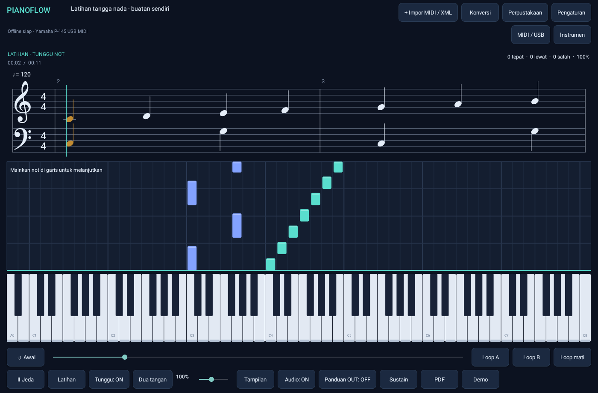
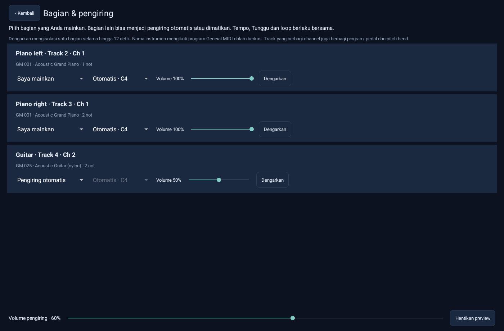
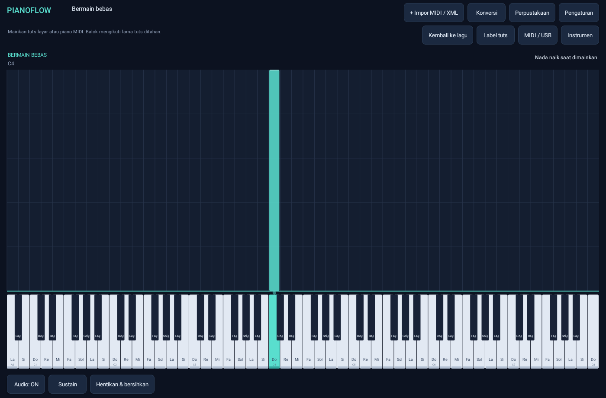

# PianoFlow

Aplikasi Android native untuk belajar piano di Huawei MatePad 11.5 S (TGR-W09, HarmonyOS 4.2) dengan Yamaha P-145 USB MIDI. Kelanjutan Arus Piano, dengan **package ID tetap `id.arus.piano`** dan sertifikat signing yang sama. Gratis, tanpa iklan, langganan, login wajib, atau kuota jumlah/durasi lagu.

**Status: 0.2.0-beta.6.** Telah dijalankan dan diuji di emulator ARM64 Android. Belum diuji pada MatePad/P-145 fisik; latensi aktual dan kompatibilitas firmware belum diukur. Lihat [verifikasi](VERIFICATION.md) dan [batasan](docs/LIMITATIONS.md).

[Unduh APK resmi](https://github.com/IkhwanN-kyp/PianoFlow/releases) · [GitHub Actions](https://github.com/IkhwanN-kyp/PianoFlow/actions) · [English overview](docs/README.en.md)



## Instalasi dan pembaruan

1. Dari GitHub Releases, pilih APK `PianoFlow-<versi>-arm64.apk`. APK ditujukan untuk Android ARM64, termasuk jalur APK HarmonyOS 4.2, dan tidak memerlukan Google Play Services. Bukan paket HarmonyOS NEXT/HAP.
2. Jika sudah memakai Arus Piano 0.1.0 dari percakapan sebelumnya, **pasang menimpa aplikasi lama; jangan uninstall**. Nama berubah menjadi PianoFlow, tetapi identitas aplikasi dan signing dipertahankan. Lagu lokal, referensi file lama, preferensi, serta checkpoint latihan tetap berada dalam penyimpanan aplikasi.
3. Izinkan pengelola berkas memasang APK bila diminta Android/HarmonyOS. Selanjutnya buka **Pengaturan > Software Update**.
4. Pilih **Beta Release** untuk versi 0.2.0-beta.6. Kanal Stable hanya menawarkan rilis stabil yang telah diterbitkan; aplikasi tidak mengarang versi stabil atau menurunkan versi beta ke versi lama.
5. Updater menampilkan versi terpasang/terbaru, catatan rilis, ukuran APK dan progres unduhan. Pemeriksaan otomatis paling sering sekali per 24 jam; pemeriksaan manual tersedia. Tidak ada instalasi diam-diam.
6. **Download & Install Update** mengunduh ke penyimpanan privat, memverifikasi SHA-256 dan tanda tangan APK, mencocokkan sertifikat, package ID dan nomor versi, lalu membuka installer sistem. Izinkan PianoFlow memasang pembaruan bila diminta. Sistem tetap meminta persetujuan instalasi.

Jika versi dengan tanda tangan lain sudah terpasang, updater menolak APK tersebut. Jangan menghapus aplikasi untuk mengatasi masalah ini jika datanya masih diperlukan; periksa sumber APK dan signing terlebih dahulu. Keamanan/distribusi dijelaskan di [UPDATES.md](docs/UPDATES.md).

## Latihan piano dengan pengiring gitar atau instrumen lain

1. Impor MIDI dari MuseScore atau sumber yang Anda boleh gunakan, lalu buka **Bagian & pengiring** pada baris atas. Bagian dibaca per **track + channel**, sehingga satu track multi-channel juga bisa dipilih terpisah. Nama track, program General MIDI, channel, serta jumlah not ditampilkan.
2. Pilih **Saya mainkan**, **Pengiring otomatis**, atau **Matikan** untuk setiap bagian. Jika piano dan instrumen lain terdeteksi dari program GM, piano disarankan untuk dimainkan dan instrumen lainnya menjadi pengiring. Jika semua bagian non-piano atau program tidak tersedia, tentukan pilihan sendiri. Dua track piano dapat dipakai untuk tangan kiri/kanan.
3. Atur **tangan** dan **volume per bagian**, lalu gunakan **Volume pengiring** untuk keseimbangan keseluruhan. **Dengarkan** mengisolasi satu bagian hingga 12 detik, dimulai dekat nada pertamanya, termasuk bagian yang sedang dimatikan. Preview menggunakan volume bagian dan suara tablet offline.
4. Kembali ke **Latihan** lalu tekan Mulai. Hanya bagian Saya mainkan yang ditampilkan dan dinilai. Pengiring berbunyi otomatis, mengikuti tempo, Tunggu, jeda, seek, serta loop yang sama. Suara yang sudah aktif dapat meluruh alami ketika jam lagu menunggu. **Dengarkan** pada layar latihan memutar semua bagian kecuali Matikan.
5. Pengaturan disimpan per lagu. Perubahan peran/tangan mengulang penilaian pada posisi yang sama; perubahan volume mempertahankan skor. Gunakan **Audio: ON / tablet** untuk suara GM dari SoundFont. MIDI OUT mempertahankan channel berkas dan memerlukan dukungan instrumen pada perangkat tujuan; P-145 tidak otomatis memiliki semua suara GM.

Track yang berbagi channel juga berbagi program, pedal, dan pitch bend. Instrumen yang sudah tercampur dalam satu track/channel tidak dipisahkan secara tebakan; ekspor ulang dari MuseScore dengan channel terpisah bila perlu. Nama instrumen mengikuti GM; SoundFont kustom bisa berbeda. Impor perkusi channel 10 masih dilewati.

Contoh asli bebas lagu komersial: [duet-asli.mid](samples/duet-asli.mid), lima not latihan piano + gitar yang dibuat khusus untuk proyek ini.



## Bermain bebas dan label tuts

- Tekan **Bermain bebas** pada baris atas, lalu mainkan tuts layar, keyboard komputer, atau piano MIDI. Tidak perlu memuat lagu atau menekan Mulai. Balok muncul dari keyboard, memanjang selama tuts ditahan dan bergerak naik setelah dilepas; velocity MIDI memengaruhi intensitasnya. Sustain memperpanjang suara, sedangkan balok mengikuti lama penekanan tuts.
- **Hentikan & bersihkan** mematikan suara dan menghapus jejak nada. **Kembali ke lagu** mempertahankan lagu, posisi dan skor dalam keadaan jeda. Mode bebas tidak menjalankan penilaian atau playback lagu. Riwayat animasi dibatasi dan jejak yang keluar layar dibersihkan otomatis.
- **Label tuts** menawarkan huruf **C D E F G A B**, angka **1 2 3 4 5 6 7**, **Do Re Mi Fa Sol La Si**, atau tanpa label. Pilihan disimpan dan berlaku di semua mode. Angka/solmisasi memakai **Do = C**, bukan transposisi; tuts hitam memakai ♯. Penanda kecil A0/C1–C8 membantu mengenali oktaf, dengan C4 sebagai C tengah.
- **Pengaturan > Bantuan & panduan** menyediakan panduan offline bertopik dalam bahasa Indonesia/Inggris. **Tentang aplikasi** memuat versi/kode versi, dukungan sukarela, kredit komponen, tautan source dan lisensi offline.



## Latihan dan sambungan P-145

Rantai yang dianjurkan: **USB TO HOST Type-B P-145 → kabel USB 2.0 A–B data (<3 m) → adaptor USB-C OTG → tablet**. Gunakan adaptor daya piano sendiri. Pilih **MIDI / USB > Input · Android MIDI API**. Jika layanan/port tidak tersedia, pilih **Cadangan · USB host MIDI 1** dan setujui izin USB. Tutup aplikasi MIDI lain yang menguasai perangkat.

Ketersediaan USB OTG dan dukungan MIDI piano belum membuktikan kompatibilitas gabungan hardware/firmware. Periksa [riset spesifikasi](RESEARCH.md). P-145 **tidak memiliki lampu tuts**. Panduan output lampu hanya mengirim Note On/Off generik untuk perangkat lain yang mendukungnya; protokol lampu SysEx khusus vendor tidak diimplementasikan.

- **Latihan / Dengarkan**: latihan menilai input; Dengarkan memutar MIDI dengan audio offline.
- **Tunggu ON**: waktu berhenti sampai seluruh not akor dimainkan. OFF menilai onset dalam ±180 ms waktu lagu.
- **88 tuts A0–C8**, multitouch, keyboard komputer (`A W S E D F T G Y H U J K O L P ;` mulai C4), serta input MIDI real-time.
- **Tempo 25–200%**, pause, seek, Loop A/B dan skor. Loop mereset skor setiap putaran, seperti versi sebelumnya.
- **Dua tangan / kiri / kanan**, pemisahan otomatis di C4 dan penetapan per track. File yang mengandung tangan menyilang memerlukan penetapan manual.
- **Perpustakaan** menyimpan salinan MIDI secara privat. Tidak ada kuota komersial. Pagar memori parser: 64 MiB/file, 500.000 event; MusicXML 16 MiB. Ini bukan batas jumlah atau durasi lagu.
- Saat aplikasi masuk latar belakang, latihan dijeda dan checkpoint disimpan. Posisi, tempo, penilaian, tangan/track serta loop disimpan per lagu. Pembaruan tidak menghapus direktori data.

Skor adalah not tepat / (tepat + lewat + tekanan salah). Bukan penilaian artikulasi, ekspresi atau teknik pedal. Not drum kanal 10 dikecualikan dari latihan piano. Skor awal 100% berarti belum ada kesalahan, bukan lagu selesai.

## Audio FluidSynth dan SoundFont

Default: **Grand Piano 1 / GM Acoustic Grand Piano (program 1)**. Grand Piano 2 memakai GM Bright Acoustic Piano. Shortcut Electric Piano, Organ, Flute, Strings dan Guitar serta pemilih **128 instrumen General MIDI** tersedia.

- FluidSynth 2.6.3 native; bank bawaan **TimGM6mb** lengkap, berlisensi GPL-2.0-only dengan copyright/lisensi disertakan. Source aplikasi MIT; lisensi bank dan library tetap terpisah.
- Velocity real-time, sustain CC64, reverb dan pilihan polyphony 32/64/128/256 suara. Playback mempertahankan pesan program/CC/pitch bend; **Ikuti program MIDI** menentukan apakah program berkas mengganti instrumen pilihan pengguna.
- **Audio > Tablet** memakai SF2 secara offline. **Audio > Yamaha P-145 / MIDI OUT** mengirim not/pesan ke port yang dipilih. Pilih output melalui MIDI / USB terlebih dahulu. Input piano tidak dipantulkan kembali sehingga tidak membentuk loop otomatis; P-145 dapat tetap memakai Local Control untuk permainan langsung.
- **Pengaturan > Impor SoundFont SF2** menyalin dan memuat bank pilihan pengguna. Bank kustom bisa memiliki subset preset; 128 label GM tidak menjamin bank kustom memiliki semua preset. Bank SF2 tambahan menjadi modul opsional melalui impor; hak pemakaian/redistribusi bank pengguna mengikuti lisensinya.
- **Gunakan SoundFont bawaan** mengembalikan bank standar. Tombol Sustain mengendalikan pedal virtual; pedal fisik ditangani dari CC64.

Audio meminta mode low latency, memakai sample rate keluaran perangkat dan blok render pendek. Itu bukan pengukuran atau jaminan latensi fisik. Jangan gunakan output panduan berjarak 0,45 detik sebagai playback audio yang sinkron; pilih routing Audio MIDI untuk playback tepat waktu.

## Konversi MP3 / WAV / M4A / FLAC → MIDI

Buka **Konversi**. Audio didekode dengan MediaExtractor/MediaCodec Android, diubah menjadi mono 22.050 Hz secara streaming, lalu diproses lokal. Tidak ada upload audio atau API berbayar.

1. Pilih audio dan gunakan **Preview audio** bila diperlukan.
2. Untuk konversi polifonik, unduh modul **`basic-pitch.tflite`** dari rilis resmi, lalu **Impor model .tflite**. Modul Spotify Basic Pitch (Apache-2.0, sekitar 200 KiB) tidak dibundel di APK utama. Hash model resmi diperiksa sebelum dimuat. Runtime TFLite CPU ikut di APK dan tidak bergantung pada Google Play Services.
3. Pilih **Basic Pitch**. Alternatif **Melodi ringan** memakai autocorrelation tanpa model dan hanya cocok untuk satu melodi, bukan akor. Ambang deteksi dapat diatur.
4. Ketuk **Konversi**. Progres dan pembatalan tersedia. Hasil adalah estimasi; musik campuran, drum, reverb kuat, vokal bertumpuk, dan banyak instrumen dapat salah terbaca. Ini bukan pemisahan stem atau transkripsi sempurna.
5. Ketuk baris not untuk mengubah pitch MIDI, onset, durasi dan velocity, atau menghapusnya. **Tambah not** menambahkan event yang dapat diedit.
6. **Preview MIDI**, **Ekspor MIDI** melalui pemilih lokasi Android, atau **Masuk latihan** untuk memuat hasil langsung.

Tempo hasil konversi default 120 BPM sebagai grid penyuntingan; model memperkirakan pitch/onset/durasi, bukan tempo, fingering atau pemisahan tangan. Implementasi postprocessing dibuat untuk Android dan tidak identik dengan seluruh pipeline Python Spotify. Model/format yang tidak didukung ditolak dengan pesan; tidak ada tombol hasil palsu.

## Partitur dan ekspor

**Tampilan > Partitur / Falling notes / Hybrid** memilih tampilan. Partitur memakai treble + bass/grand staff, tempo map, tanda birama, not/accidental, garis ledger dan durasi sederhana. Highlight mengikuti posisi dan input/penilaian yang sama dengan falling notes. Kuantisasi 1/16 hanya untuk gambar, tidak menggeser waktu latihan MIDI.

Impor **MusicXML `.xml` / `.musicxml` score-partwise tidak terkompresi** melalui tombol impor. Divisions, chord, backup/forward, staff, tempo dan meter didukung. DTD/entity eksternal ditolak. `.mxl` terkompresi, score-timewise, repeat expansion, ornament, tie/voice engraving kompleks dan seluruh semantik MusicXML belum didukung.

Tombol **PDF** mengekspor partitur multipage melalui PdfDocument Android. Ini notasi untuk belajar, **bukan engraving profesional**: ejaan enharmonik sederhana, not panjang/lintas birama dan ritme kompleks dapat memerlukan editor partitur khusus. Pagar ekspor PDF 300 halaman mencegah kehabisan memori.

## Tampilan, privasi dan modul

Landscape, kanvas responsif dan rasio target 2800 × 1840. Tema gelap/terang dan Bahasa Indonesia/English tersedia di Pengaturan. Diagnostik sistem/library dapat tetap berbahasa Inggris. SoundFont tambahan dan model AI diimpor terpisah; APK tidak berisi bank besar atau model tersembunyi.

Aplikasi meminta internet hanya untuk GitHub Releases/updater. Audio, MIDI, MusicXML dan SoundFont diproses di perangkat. Tidak ada login wajib, analytics, iklan atau akses mikrofon. URI, lagu, checkpoint dan preferensi disimpan di penyimpanan privat aplikasi. Uninstall tetap menghapus data menurut perilaku Android; pembaruan normal tidak melakukan uninstall.

## Build, pengujian dan kontribusi

Lihat [DEVELOPMENT.md](docs/DEVELOPMENT.md), [UPDATES.md](docs/UPDATES.md) dan [THIRD_PARTY_NOTICES.md](THIRD_PARTY_NOTICES.md).

Persyaratan: JDK 17, SDK platform 35/build-tools 35.0.0, NDK 27.2.12479018, CMake 3.22.1. Gradle Wrapper 8.10.2 dan AGP 8.7.3 disertakan. Minimum API 24, target 35, APK rilis ARM64. x86_64 tersedia hanya sebagai pilihan build pengujian.

```sh
python3 scripts/verify_vendor.py
./test-core.sh
./gradlew :app:assembleDebug :app:lintDebug
```

Rilis resmi dibangun/ditandatangani oleh GitHub Actions dari tag SemVer. Signing key berada di GitHub Secrets, tidak di repository. Fork harus memakai key sendiri dan mengubah pin updater; APK fork tidak dapat menggantikan APK resmi.

## Bantu PianoFlow terus berkembang

Masukan, ide, dan kontribusi Anda membantu PianoFlow menjadi teman belajar piano yang semakin baik. Jika PianoFlow bermanfaat, Anda dapat mendukung pengembangannya melalui [Trakteer @radarswingid](https://trakteer.id/radarswingid). Dukungan Anda memberi waktu dan semangat untuk menghadirkan perbaikan serta fitur baru. Terima kasih sudah menjadi bagian dari perjalanan PianoFlow.

Dukungan bersifat sukarela. Seluruh fitur tetap gratis dan dapat digunakan tanpa donasi. Kredit: **PianoFlow · @radarswingid**. Di aplikasi, buka **Pengaturan > Tentang aplikasi** untuk melihat versi, kode versi, tautan sumber, serta lisensi offline.

PianoFlow dikembangkan secara mandiri, dengan MIDIVisualizer sebagai referensi visual, bukan fork. Daftar sumber dan kewajiban lisensi tersedia di [THIRD_PARTY_NOTICES.md](THIRD_PARTY_NOTICES.md); atribusi tidak menggantikan kewajiban lisensi masing-masing komponen.
