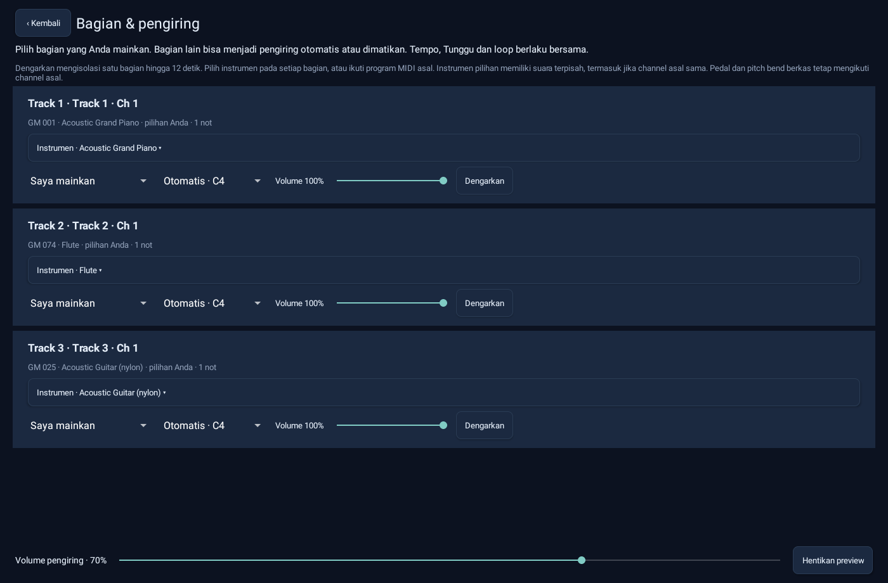
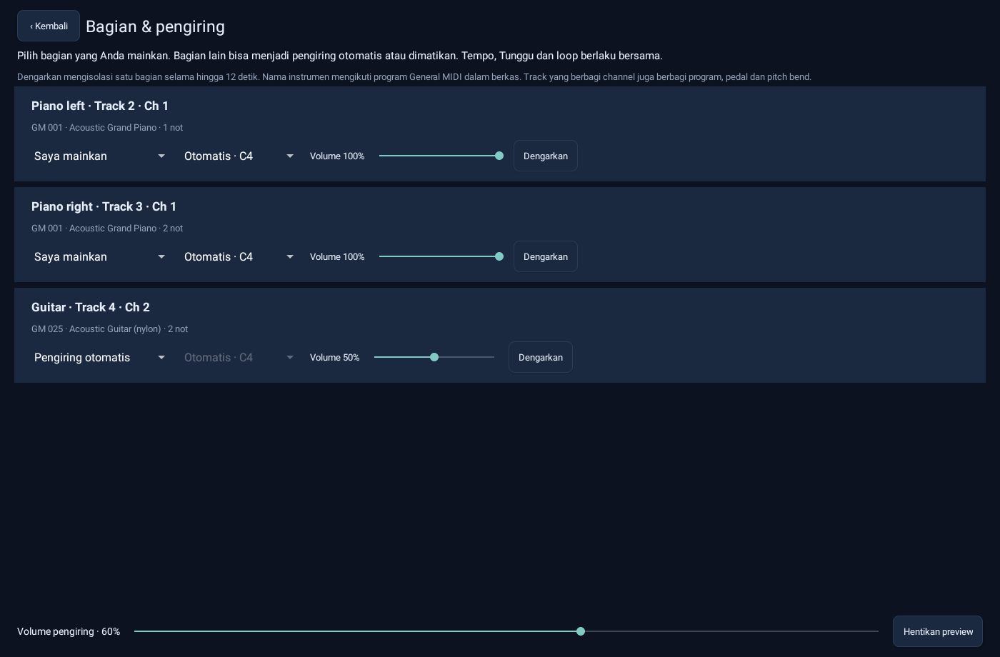
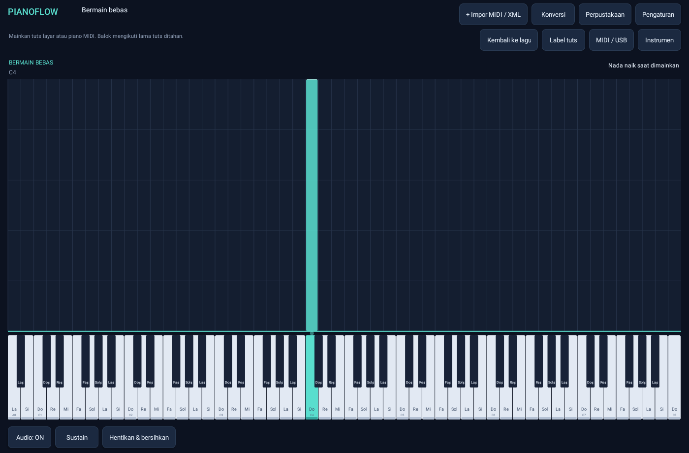
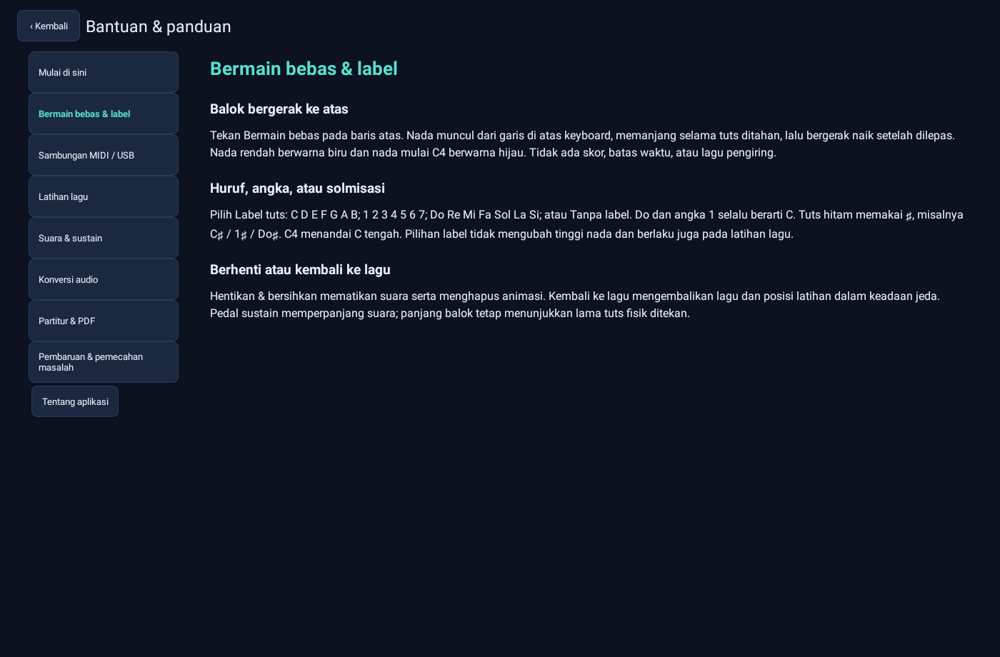
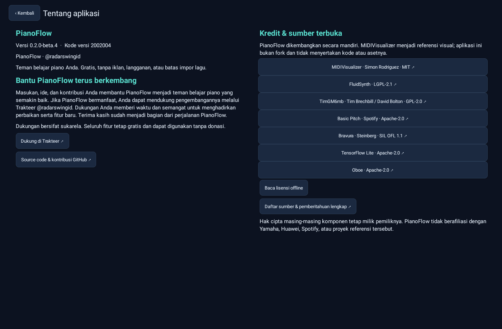

# Verifikasi PianoFlow 0.2.0-beta.7

Diperiksa 26 November 2026 (Asia/Jakarta). Hasil kompilasi, emulator dan hardware dipisahkan.

## Instrumen per bagian beta.7

- Pilihan cepat Piano/Flute/Guitar/EP/Organ/Strings, daftar lengkap 128 GM, serta Follow MIDI tersedia sebagai dialog native pada setiap kartu bagian. Pilihan disimpan per lagu, termasuk pada snapshot/fresh arrangement, tanpa menulis ulang MIDI atau mengubah konfigurasi penilaian.
- 43 assertion + 300 mutasi MIDI, 110 extended, 391 live-learning, 40 arrangement, dan **160 pemeriksaan override instrumen** lolos. Termasuk isolasi tiga preset dari channel asal yang sama, bank/program berkas yang tidak menimpa preset tetap, pedal, seek/loop, Note Off independen, seluruh nomor GM, MIDI OUT, serta kapasitas route yang dilaporkan secara eksplisit.
- **262 pemeriksaan Android ARM64** lolos. Menu benar-benar dipilih melalui widget dialog Android, semua 129 opsi (Follow + 128 GM) diperiksa. FluidSynth dikueri untuk membuktikan program piano 0, flute 73, dan gitar 24 aktif pada jalur terpisah. Preview tetap flute setelah event PC/bank MIDI berkas; suara live tidak menimpa program bagian; pilihan dan skor bertahan saat kembali ke latihan.
- Sample PCM nonzero dan preset flute diverifikasi pada private channel 57 dan 255, termasuk setelah panic/reset: channel tinggi tidak alias ke channel lain atau berubah menjadi drum. Engine 256 channel menyisakan 0–31 untuk live, 32–47 untuk Follow MIDI, dan 48–255 untuk hingga 208 instrumen tetap. Polyphony suara tetap dapat diatur terpisah.
- MIDI OUT memetakan instrumen tetap ke channel melodis yang tersedia dan tidak mengklaim semua perangkat mendukung GM. MatePad/P-145 fisik serta latensi USB/audio tetap belum diuji. SF2 kustom yang tidak lengkap mungkin tidak menyediakan preset yang diminta.

Rilis beta.7 berhasil melewati job test/release: https://github.com/IkhwanN-kyp/PianoFlow/actions/runs/45749843623 . CI tanpa Google Play Services lulus 255 pemeriksaan runtime dan 160 pemeriksaan override instrumen; fixture privat menambah runtime ARM64 menjadi 262. APK resmi dipasang menimpa versi emulator dan kembali lulus 262 pemeriksaan, termasuk marker data lama. Package `id.arus.piano`, versi `0.2.0-beta.7`, kode `2002007`, non-debuggable, sertifikat sama. Ukuran 27.188.240 byte; SHA-256 `42fda0f0f62cae149d854eacdd715bb6d02fc2f63b7107f7946fdfe07e8a7396` dan signature diperiksa setelah unduhan. Rilis: https://github.com/IkhwanN-kyp/PianoFlow/releases/tag/v0.2.0-beta.7 .

## Bagian instrumen dan pengiring beta.6

- 43 assertion parser/trainer + 300 mutasi MIDI, 110 pemeriksaan extended, dan 391 pemeriksaan live-learning tetap lolos. Tambahan 40 pemeriksaan aransemen mencakup grouping track/channel, GM, pemilihan learner/backing/mute, penilaian/tampilan, wait/tempo, sustain, seek/loop, volume, solo, unison/overlap, dan roundtrip provenance pesan MIDI.
- Build ARM64 dan lint berhasil; **223 pemeriksaan runtime emulator Android ARM64** lolos. Pengujian Android mencakup impor MIDI asli piano kiri/kanan + gitar, pemutaran gitar pada latihan tanpa auto-play piano, preview part yang di-mute menggunakan AudioTrack native, kontrol peran nyata, pengubahan volume lewat sentuhan, serta pemulihan konfigurasi per lagu saat kembali ke latihan.
- Dua track belajar yang memainkan pitch/onset sama dipenuhi satu penekanan; Note Off satu part tidak memutus unison part lain. Pilihan suara pemain tidak mengubah program GM pengiring tablet. Program/pedal/bend tetap state channel bersama; instrumen yang tercampur dalam satu track/channel tidak ditebak terpisah. Perkusi channel 10 masih dilewati.
- Bank dan sumber vendor tetap dipin; tidak ada lagu komersial baru. `samples/duet-asli.mid` adalah lima not orisinal yang dihasilkan oleh tes. Pengujian fisik MatePad/P-145, dukungan suara GM perangkat MIDI OUT, dan latensi USB/audio tetap belum dilakukan.

Rilis beta.6 berhasil melewati job test dan release otomatis: https://github.com/IkhwanN-kyp/PianoFlow/actions/runs/45738228357 . CI Android tanpa Google Play Services lulus 216 pemeriksaan runtime; fixture privat menambah pemeriksaan ARM64 menjadi 223. APK resmi dipasang menimpa versi emulator dan kembali lulus 223 pemeriksaan, termasuk marker data lama yang tetap terbaca. Package `id.arus.piano`, versi `0.2.0-beta.6`, kode `2002006`, non-debuggable, sertifikat tetap sama. Ukuran 27.171.856 byte; SHA-256 `6428201a3e49e6ecfc6035b484f4155fdfc0205befb5ee7a6138778055ac3e47` serta signature diverifikasi ulang setelah unduhan. Rilis: https://github.com/IkhwanN-kyp/PianoFlow/releases/tag/v0.2.0-beta.6 .

## Bermain bebas, label, dan panduan beta.5

- Build native ARM64 dan Android lint berhasil; pemeriksaan core lama 43 assertion + 300 mutasi dan 110 pemeriksaan tetap lolos. Tambahan 391 pemeriksaan mencakup arah/durasi jejak, memori terbatas, retrigger, batas input, serta label 88 tuts.
- Emulator ARM64 Android 11/API 30 lulus 207 pemeriksaan runtime. Termasuk pembuktian melalui piksel bahwa balok bergerak ke atas, akor touch, MIDI velocity, nada sama dari dua sumber, Note Off, putus MIDI, background/resume, serta lagu/posisi/skor yang dipertahankan saat berganti mode.
- Semua pilihan label dirender. Pilihan Do–Re–Mi melalui menu benar-benar tersimpan setelah proses aplikasi ditutup dan diluncurkan kembali. Screenshot berasal dari aplikasi native, bukan mockup.
- Bantuan bertopik diuji dalam Indonesia/tema gelap dan English/tema terang. Tentang memuat versi/kode, informasi fitur, panduan, kredit dan lisensi yang tetap tersedia.
- Belum diuji dengan MatePad/P-145 fisik; latensi USB dan audio tidak diukur. Animasi mengikuti penekanan fisik tuts, bukan lamanya decay suara setelah sustain.

Rilis resmi beta.5 berhasil melewati kedua job test/release di https://github.com/IkhwanN-kyp/PianoFlow/actions/runs/45716349721 . CI Android tanpa Google Play Services lulus 200 pemeriksaan runtime dan 391 pemeriksaan live-learning; tujuh fixture privat menambah pemeriksaan lokal ARM64 menjadi 207. APK resmi dipasang menimpa versi emulator dan kembali lulus 207 pemeriksaan, termasuk marker data lama yang tetap terbaca. Package `id.arus.piano`, versi `0.2.0-beta.5`, kode `2002005`, non-debuggable, sertifikat tetap sama. Ukuran 27.171.832 byte; SHA-256 `db5f0bc0a95454f31cc21afb748f2a867d35dc89b7b97ec0ae525c4a69ee9dbd` dicocokkan dengan manifest dan signature APK diverifikasi setelah unduhan.

## Koreksi nama beta.4

Seluruh teks dukungan dan kredit menggunakan PianoFlow, dengan @radarswingid dan tautan Trakteer tetap dipertahankan. Versi 0.2.0-beta.4, kode 2002004. Build ARM64 dan lint berhasil; 185 pemeriksaan emulator ARM64 lulus, termasuk judul dukungan PianoFlow pada kedua bahasa. Pratinjau halaman Tentang diperbarui.

## Kredit dan halaman Tentang beta.3

Build ARM64 dan lint berhasil. Emulator ARM64 lulus **185 pemeriksaan runtime**, termasuk versi/kode versi yang berasal dari BuildConfig, kredit PianoFlow, dukungan sukarela, atribusi bukan-fork, serta render landscape dalam bahasa Indonesia/tema gelap dan English/tema terang. Core 43 assertion + 300 mutasi dan 110 pemeriksaan tambahan tetap lolos; enam regresi release tools dan 23 hash vendor/source lolos. Halaman Tentang memuat tautan GitHub/Trakteer dan pembaca teks lisensi offline. Pengujian perangkat fisik tetap belum dilakukan.

Beta.3 diterbitkan otomatis dengan job test dan release sukses: https://github.com/IkhwanN-kyp/PianoFlow/actions/runs/45710616182 . CI tanpa Google Play Services lulus 178 pemeriksaan runtime (fixture privat ARM64 menambahkan tujuh pemeriksaan lokal). APK resmi berukuran 27.155.424 byte, non-debuggable, package `id.arus.piano`, versi `0.2.0-beta.3`, kode `2002003`; checksum dan signature diverifikasi ulang setelah unduhan. SHA-256: `1aa3fd824feb8b98eaf37baa22ff991a03657ae78a92af893069350c26ae976a`. Sertifikat sama dengan versi terdahulu. APK resmi berhasil dipasang menimpa versi emulator dan lulus kembali 185 pemeriksaan runtime, termasuk marker data lama yang tetap terbaca. Rilis: https://github.com/IkhwanN-kyp/PianoFlow/releases/tag/v0.2.0-beta.3 .

## Distribusi dan perbaikan penyimpanan

Pipeline beta.1 sudah berhasil membangun, menguji, menandatangani dan memublikasikan APK: https://github.com/IkhwanN-kyp/PianoFlow/actions/runs/45603260090 . Beta.2 mempertahankan ID/nama/track kosong saat ekspor sehingga penetapan tangan tidak bergeser pada impor baru; regresi metadata dan track ditambahkan. File beta.1 tetap dapat dibaca.

## Bukti yang sudah ada

- JDK 17, Gradle 8.10.2, AGP 8.7.3, SDK/build-tools 35, NDK 27.2.12479018 dan CMake 3.22.1; build native ARM64 serta Android lint berhasil.
- Core: **43 assertion + 300 mutasi MIDI rusak**, ditambah **110 pemeriksaan** export MIDI, tempo/meter, MusicXML/XXE, grid partitur, GM, MIDI CC dan SemVer.
- Emulator Android 11/API 30 ARM64, landscape 1400 × 920 (rasio 2800 × 1840), tanpa Google Play Services: **171 pemeriksaan runtime** lolos pada tahap integrasi, kemudian **177 pemeriksaan** setelah menambahkan tes keamanan updater.
- Termasuk fitur latihan lama, audio FluidSynth/AudioTrack, 128 preset GM yang benar-benar menghasilkan sampel audio, amplitudo velocity, sustain down/up, WAV decode/resample dan deteksi akor C–E–G melalui Basic Pitch.
- Decoder MP3, WAV, M4A dan FLAC diuji dengan akor sintetis asli, bukan lagu komersial. M4A dibuat dengan AAC encoder Android; MP3/FLAC berasal dari fixture asli yang sama.
- MusicXML dengan grand staff/meter berhasil diparse pada parser Android; DTD eksternal ditolak. PDF diekspor, dibuka dengan PdfRenderer dan diverifikasi berisi staff/not.
- Ketiga tampilan dirender; palette light dan terjemahan English diperiksa.
- APK baru dipasang di atas Arus Piano 0.1.0 tanpa uninstall; marker privat `preserved-v0.1.0` tetap terbaca. Sertifikat tetap sama.
- Hash 23 binary/asset/model/font/bank dan corresponding native sources dipin serta diperiksa. Kunci signing dipindahkan ke PKCS12 privat berkata sandi acak dan GitHub Actions Secrets; tidak dimasukkan ke source.

Tambahan enam tes updater memakai APK bertanda tangan asli dengan versi lebih tinggi, checksum keliru, metadata versi keliru, APK versi sama/downgrade, APK dengan signer lain, serta APK yang payload-nya dirusak meskipun checksum metadata disesuaikan. APK resmi diterima; kelima kasus penolakan lolos. APK fixture hanya dipakai di emulator, tidak dipublikasikan sebagai versi produk.

## Hasil distribusi resmi

- Beta.2 berhasil dibangun, diuji, ditandatangani dan dipublikasikan otomatis: https://github.com/IkhwanN-kyp/PianoFlow/actions/runs/45605672941 . Kedua job test dan release berstatus success. Rilis: https://github.com/IkhwanN-kyp/PianoFlow/releases/tag/v0.2.0-beta.2 .
- SHA-256 APK resmi: `9e3dabae06f0b3a2f0ce5bfcb8b2fbe18563be249d04f9433bd681ed160d275e`; 27.154.617 byte; package `id.arus.piano`; versionCode `2002002`; APK Signature Scheme v2 valid, sertifikat sama dan non-debuggable.
- Aplikasi beta.1 resmi berhasil membaca beta.2 melalui GitHub Releases API dan menampilkan versi terpasang/terbaru, ukuran 25,90 MiB, kanal Beta serta changelog yang benar. Uji end-to-end selesai 26 November 2026: unduhan, verifikasi, izin unknown-source, dialog konfirmasi Android dan instalasi beta.1 → beta.2 berhasil. PackageManager menunjukkan versionName `0.2.0-beta.2` dan versionCode `2002002` setelah instalasi tanpa uninstall. Perpustakaan masih menampilkan `converted.mid` dan lagu impor sebelumnya. Tab Konversi juga tetap menampilkan `Basic Pitch · model siap` setelah update.
- Alur UI konversi diuji secara manual: impor model resmi dari Downloads, pilih WAV asli, jalankan Basic Pitch, buka editor not, hapus satu not estimasi, dan Masuk latihan. Hasil terkoreksi benar-benar muncul di latihan/perpustakaan.
- Catatan rilis diperbaiki dan ditambah regresi parser batas bagian changelog. Ini perubahan tooling/metadata; tidak mengubah APK yang sudah diterbitkan.

## Belum dibuktikan oleh emulator

Tidak ada Huawei TGR-W09, Yamaha P-145, kabel USB/OTG atau keyboard lampu fisik yang terhubung. Belum terbukti: kompatibilitas firmware HarmonyOS 4.2, input/output USB end-to-end, descriptor/driver, hot-unplug pada perangkat tersebut, MIDI output ke speaker piano, latensi akustik, kualitas timbre pada speaker tablet, multitouch fisik sepuluh jari dan sesi berjam-jam.

Tes MIDI sintetis memanggil listener produksi; itu bukan transfer USB fisik. Render PCM dan inferensi akor uji bukan jaminan kualitas transkripsi seluruh lagu. Keberhasilan installer pada Android emulator juga tidak menghapus kebutuhan uji izin/installer OEM Huawei. Lihat docs/LIMITATIONS.md.

## Uji penerimaan perangkat pengguna

1. Pasang menimpa APK Arus Piano lama; periksa data/lagu sebelumnya dan checkpoint.
2. Dalam mode pesawat, coba Grand Piano 1, velocity, sustain dan beberapa instrumen. Coba SF2 kustom yang izinnya jelas.
3. Sambungkan P-145 dengan kabel data USB 2.0 + OTG dan catu daya piano sendiri. Coba Android MIDI, kemudian raw USB bila perlu. Periksa note-on/off, pedal dan cabut-pasang.
4. Coba wait chord, ritme, tempo 50/100/150%, tangan, loop, pause serta partitur/hybrid.
5. Impor modul Basic Pitch resmi dan rekaman solo buatan sendiri; koreksi hasil, ekspor MIDI dan masuk latihan. Coba MusicXML sederhana serta PDF.
6. Periksa Settings > Software Update, kanal Stable/Beta, unduhan, verifikasi, izin unknown-source dan konfirmasi installer. Jangan uninstall untuk melakukan update.
